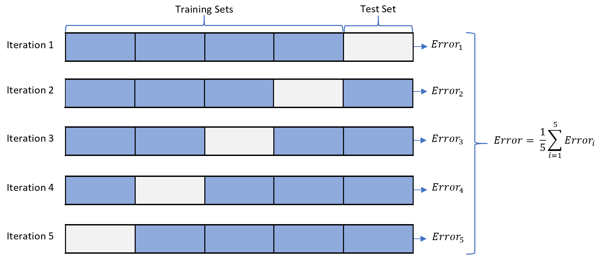

```{r setup, include = FALSE}
# Cartoons from https://github.com/allisonhorst/stats-illustrations
# dplyr based upon https://allisonhorst.shinyapps.io/dplyr-learnr/#section-welcome

source('../config.R')

options(width = 120)

library(gganimate)
library(magick)
library(cowplot)
library(DT)
source('../R/roc.R')
# library(titanic)
# data("titanic")
library(VisualStats)
# library(VisualMLE)
```

class: center, middle, inverse, title-slide

# `r metadata$title`
## `r metadata$subtitle`
### `r metadata$author`
### `r metadata$date`


---
# Bootstrapping

* First introduced by Efron (1979) in [*Bootstrap Methods: Another Look at the Jackknife*](https://projecteuclid.org/euclid.aos/1176344552).

* Estimates confidence of statistics by resampling *with* replacement.

* The *bootstrap sample* provides an estimate of the sampling distribution.

* The `boot` R package provides a framework for doing bootstrapping: https://www.statmethods.net/advstats/bootstrapping.html

---
# Bootstrapping Example (Population)

Define our population with a uniform distribution.

```{r}
n <- 1e5
pop <- runif(n, 0, 1)
mean(pop)
```

```{r, echo=FALSE, fig.height=5}
d <- density(pop)
h <- hist(pop, plot=FALSE)
hist(pop, main='Population Distribution', xlab="", freq=FALSE, 
     ylim=c(0, max(d$y, h$density)+.5), col='steelblue', border = "white", 
	 cex.main = 1.5, cex.axis = 1.5, cex.lab = 1.5)
lines(d, lwd=3)
```

---
# Bootstrapping Example (Sample)

We observe one random sample from the population.

```{r}
samp1 <- sample(pop, size = 50)
```

```{r, echo=FALSE}
d <- density(samp1)
h <- hist(samp1, plot=FALSE)
hist(samp1, main='Distribution of Sample', xlab="", freq=FALSE, 
     ylim=c(0, max(d$y, h$density)+.5), col='steelblue', border = "white", 
	 cex.main = 1.5, cex.axis = 1.5, cex.lab = 1.5)
lines(d, lwd=3)
```

---
# Bootsrapping Example (Estimate)

```{r}
boot.samples <- numeric(1000) # 1,000 bootstrap samples
for(i in seq_along(boot.samples)) { 
	tmp <- sample(samp1, size = length(samp1), replace = TRUE)
	boot.samples[i] <- mean(tmp)
}
head(boot.samples)
```

---
# Bootsrapping Example (Distribution)

```{r, fig.height = 6}
d <- density(boot.samples)
h <- hist(boot.samples, plot=FALSE)
hist(boot.samples, main='Bootstrap Distribution', xlab="", freq=FALSE, 
     ylim=c(0, max(d$y, h$density)+.5), col='steelblue', border = "white", 
	 cex.main = 1.5, cex.axis = 1.5, cex.lab = 1.5)
lines(d, lwd=3)
```

---
# 95% confidence interval

```{r}
c(mean(boot.samples) - 1.96 * sd(boot.samples), 
  mean(boot.samples) + 1.96 * sd(boot.samples))
```

The standard deviation of the bootstrap sample is an approximation of the standard error.

---
# Bootstrapping is not just for means!

```{r}
boot.samples.median <- numeric(1000) # 1,000 bootstrap samples
for(i in seq_along(boot.samples.median)) { 
	tmp <- sample(samp1, size = length(samp1), replace = TRUE)
	boot.samples.median[i] <- median(tmp) # NOTICE WE ARE NOW USING THE median FUNCTION!
}
head(boot.samples.median)
```

95% confidence interval for the median

```{r}
c(mean(boot.samples.median) - 1.96 * sd(boot.samples.median), 
  mean(boot.samples.median) + 1.96 * sd(boot.samples.median))
```

---
class: font80
# Boostrap for linear regression (custom function)

```{r}
lm_boot <- function(formula, data, R = 1000, ...) {
	results <- list()                                                                   # Object to save our results
	results$full_model <- lm(formula = formula, data = data, ...)                       # Run the full model
	results$coeficients <- data.frame(row.names = 1:R)                                  # Data frame to store the coeficients
	for(i in names(results$full_model$coefficients)) {
		results$coeficients[,i] <- NA
	}
	results$fit <- data.frame(row.names = 1:R,                                          # Data frame for the fit statistics
							  F_statistic = rep(NA, R),
							  df_numerator = rep(NA, R),
							  df_denominator = rep(NA, R),
							  R_squared = rep(NA, R),
							  Adjusted_R_squared = rep(NA, R))
	results$sample <- list()                                                            # This will contain the vectors for
	for(i in seq_len(R)) {                                                              # for the bootstrap samples.
		results$sample <- sample(nrow(data), size = nrow(data), replace = TRUE)
		boot_data <- data[results$sample,]
		boot_lm_out <- lm(formula = formula, data = boot_data, ...)                     # Calling lm with the bootstrap sample
		boot_lm_out_summary <- summary(boot_lm_out)
		results$coeficients[i,] <- boot_lm_out$coefficients                             # Saving all the results
		results$fit[i,] <- c(boot_lm_out_summary$fstatistic, 
							 boot_lm_out_summary$r.squared, 
							 boot_lm_out_summary$adj.r.squared)
	}
	class(results) <- c('lmboot', 'list')                                               # Changing the class so we can write
	return(results)                                                                     # custom S3 methods for plot and summary
}
```

---
# S3 OOB and "generic" functions

S3 is an objected oriented framework that works by defining conventions. There are many functions that are considered "generic." You can always tell "generic" functions as the implementation calls a function `UseMethod('function_name')` where `function_name` is the name of the generic (e.g. `plot`, `summary`).

```{r}
plot
```

Objects can have different classes. On the previous slide we changed the `class` to `lmboot`. The `UseMethod` will look for a function with the following format: `generic_function.class_name()`.

When we call `plot()` with our result from `lm_boot()`, R will actually call `plot.lm_boot()`.

---
class: font80
# Summary and Plot functions

.pull-left[

Here we are defining the S3 methods for `plot` and `summary`.

```{r}
plot.lmboot <- function(x, ...) {
	coef <- reshape2::melt(x$coeficients, id.vars = NULL)
	ggplot2::ggplot(coef, ggplot2::aes(x = value, y = variable)) + 
		ggdist::stat_halfeye(side = 'top') +
		ggplot2::scale_y_discrete(limits = rev) +
		ggplot2::xlab('Estimate')
}
```


]
.pull-right[

```{r}
summary.lmboot <- function(object, ...) {
	ncols <- ncol(object$coeficients)
	summary_table <- data.frame(
		row.names = names(object$coeficients),
		boot_mean = rep(NA, ncols),
		boot_se = rep(NA, ncols),
		boot_median = rep(NA, ncols))
	for(i in row.names(summary_table)) {
		summary_table[i,] <- c(
			mean(object$coeficients[,i]),
			sd(object$coeficients[,i]),
			median(object$coeficients[,i])
		)
	}
	summary_table <- cbind(
		summary(object$full_model)$coefficients[,1:2],
		summary_table) |> as.data.frame()
	cat('Coefficients:\n')
	print(summary_table)
	cat('\nR-Squared:', mean(object$fit$R_squared), 
		'(se =', sd(object$fit$R_squared), ')\n')
	cat('Adjusted R-Squared:', mean(object$fit$Adjusted_R_squared), 
		'(se =', sd(object$fit$Adjusted_R_squared), ')')
	invisible(summary_table)
}
```


]

---
# Using our custom functions

```{r}
data('Auto', package = 'ISLR2')
boot_out <- lm_boot(mpg ~ cylinders + displacement + horsepower + weight + acceleration + year, data = Auto)
summary(boot_out)
```

---
# Plot function

```{r}
plot(boot_out)
```


---
class: font80
# Bootstrap for linear regression (using `car::Boot`)

There are other frameworks for bootstrapping including the [`boot`](https://cran.r-project.org/web/packages/boot/index.html) package and the `Boot()` function in the `car` package. First, we estimate the full model.

```{r}
lm_out <- lm(mpg ~ cylinders + displacement + horsepower + weight + acceleration + year, data = Auto)
summary(lm_out)
```

---
class: font80
# Bootstrap for linear regression (using `car::Boot`)

.pull-left[
Then we pass the results to the `car::Boot()` function.

```{r}
set.seed(2112)
lm_boot <- car::Boot(lm_out)
summary(lm_boot)
```

]
.pull-right[
Instead of using standard error (remember which is the standard deviation of the bootstrap distribution), we can use quantiles, here the 2.5% and 97.5% percentiles. This may be better if the bootstrap distribution does not reasonably approximate the normal distribution (although the CLT indicates it should in most situations).

```{r}
confint(lm_boot, level = 0.95, type = "perc")
```

]

---
# Plotting the results


```{r}
hist(lm_boot)
```


---
# k-fold validation

```{r, echo=FALSE}

```

---
# Using `tidymodels` for k-fold validation

```{r}
set.seed(2112)
folds <- rsample::vfold_cv(Auto, v = 5)

# Define the model type (e.g., Linear Regression)
lm_spec <- parsnip::linear_reg() |> parsnip::set_engine("lm")

# Fit the model across all resamples
cv_results <- tune::fit_resamples(
  lm_spec,
  preprocessor = mpg ~ cylinders + displacement + horsepower + weight + acceleration + year,
  resamples = folds
)

# Extract evaluation metrics (RMSE, R-squared)
tune::collect_metrics(cv_results)
```


---
# Recommendations to Prevent Overfitting

1. Split your dataset into a training and validation dataset (typically 70/30 works, but can vary depending on sample size).

2. Use k-fold validation when fitting different models (k = 10 is pretty common). This can be different modeling strategies (e.g. regression, trees, etc.) or different variable sets.

3. Once you decide on the best model in step 3, estimate your model fit statistics with the validation dataset created (and set aside) in step 1. 

---
class: left, font120
# One Minute Paper

.pull-left[
1. What was the most important thing you learned during this class?

2. What important question remains unanswered for you?
]
.pull-right[
```{r, echo=FALSE, fig.width=5, fig.height=5}
omp_link <- get_omp_link(
	course = course,
	semester = paste0(semester, year),
	topic = 'Resampling Methods'
)
qrcode::qr_code(omp_link) |> plot(col = c('#FAFAFA', 'black'))
```
.center[.font50[[Scan the QR code or click here to  
complete the One Minute Paper](`r omp_link`)]]
]

