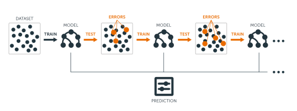
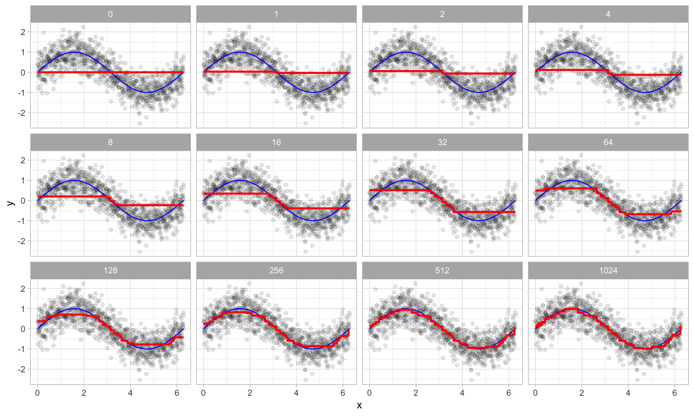

```{r setup, include = FALSE}
# Cartoons from https://github.com/allisonhorst/stats-illustrations
# dplyr based upon https://allisonhorst.shinyapps.io/dplyr-learnr/#section-welcome

source('../config.R')

library(gganimate)
library(magick)
library(cowplot)
library(DT)
source('../R/roc.R')
# library(titanic)
# data("titanic")
library(VisualStats)
# library(VisualMLE)
```

class: center, middle, inverse, title-slide

# `r metadata$title`
## `r metadata$subtitle`
### `r metadata$author`
### `r metadata$date`


```{r setup2, include=FALSE}
library(ggplot2)
library(grid)
library(VIM)
library(mice)
library(reshape2)

library(tree)
library(rpart)
library(party)
library(randomForest)
library(randomForestExplainer)
library(ggplot2)
library(mice)
library(ROCR)
library(TriMatch)
library(tidymodels)
library(caret)
library(patchwork)
library(ROCR)

par(mfrow = c(1,1), xpd = NA) #To prevent text from being clipped
par(bg="white", mai=c(1.2,1.5,1,1))

titanic <- read.csv('../course_data/titanic3.csv', stringsAsFactors = FALSE)
titanic$sex <- as.factor(titanic$sex)
titanic.mice <- mice::mice(titanic[,c("pclass","sex","age","sibsp")], m=1)
titanic <- cbind(survived=titanic$survived, mice::complete(titanic.mice))

titanic.split <- rsample::initial_split(titanic, strata = 'survived')
titanic.train <- rsample::training(titanic.split)
titanic.valid <- rsample::testing(titanic.split)

calif <- read.table('../course_data/cadata.dat', header=TRUE)
price.quintiles <- quantile(calif$MedianHouseValue, props = seq(0, 1, 0.2))
calif$cut.prices <- cut(calif$MedianHouseValue, price.quintiles, include.lowest=TRUE)
calif.split <- rsample::initial_split(calif, strata = 'cut.prices')
calif.train <- rsample::training(calif.split)
calif.valid <- rsample::testing(calif.split)

```


---
# Ensemble Methods

Ensemble methods use multiple models that are combined by weighting, or averaging, each individual model to provide an overall estimate. Each model is a random sample of the sample. Common ensemble methods include:

* *Bagging* - Each tree is estimated independent of other trees. A simple “majority vote” is take for the prediction.

* *Boosting* - Each successive trees give extra weight to points incorrectly predicted by earlier trees. After all trees have been estimated, the prediction is determined by a weighted “vote” of all predictions (i.e. results of each individual tree model).

* *Random Forests* - In addition to randomly sampling the data for each model, each split is selected from a random subset of all predictors.

* *Super Learner* - An ensemble of ensembles. See https://cran.r-project.org/web/packages/SuperLearner/vignettes/Guide-to-SuperLearner.html

---
class: font80
# Random Forests

The random forest algorithm works as follows:

1. Draw $n_{tree}$ bootstrap samples from the original data.

2. For each bootstrap sample, grow an unpruned tree. At each node, randomly sample $m_{try}$ predictors and choose the best split among those predictors selected<footnote>Bagging is a special case of random forests where $m_{try} = p$ where *p* is the number of predictors</footnote>.

3. Predict new data by aggregating the predictions of the ntree trees (majority votes for classification, average for regression).

--

Error rates are obtained as follows:

1. At each bootstrap iteration predict data not in the bootstrap sample (what Breiman calls “out-of-bag”, or OOB, data) using the tree grown with the bootstrap sample.

2. Aggregate the OOB predictions. On average, each data point would be out-of-bag 36% of the times, so aggregate these predictions. The calculated error rate is called the OOB estimate of the error rate.

---
# Random Forests: Titanic

```{r titanicRF, cache=TRUE}
titanic.rf <- randomForest(factor(survived) ~ pclass + sex + age + sibsp,
						   data = titanic.train,
						   ntree = 5000,
						   importance = TRUE)
```

```{r}
importance(titanic.rf)
```

---
# Random Forests: Titanic (cont.)

```{r}
importance(titanic.rf)
```


---
# Random Forests: Titanic

```{r randomForestExplainer, cache=TRUE}
min_depth_frame <- min_depth_distribution(titanic.rf)
```


```{r, fig.width = 11, fig.height=5}
plot_min_depth_distribution(min_depth_frame)
```


---
# Bagging

The general idea behind bagging is referred to as the "wisdom of the crowd" effect and was popularized by Surowiecki (2005). It essentially means that the aggregation of information in large diverse groups results in decisions that are often better than could have been made by any single member of the group. The more diverse the group members are then the more diverse their perspectives and predictions will be, which often leads to better aggregated information. Think of estimating the number of jelly beans in a jar at a carnival. While any individual guess is likely to be way off, you’ll often find that the averaged guesses tends to be a lot closer to the true number.

.font60[Adapted from https://bradleyboehmke.github.io/HOML/bagging.html]

---
# Bagging using the `ipred` package

```{r}
titanic_bag <- ipred::bagging(
	formula = factor(survived) ~ pclass + sex + age + sibsp,
	data = titanic.train,
	nbag = 100,
	coob = TRUE # whether an out-of-bag estimate of the error rate should be computed.
)
titanic_bag
```

---
# Bagging using the `ipred` package


```{r}
bag_predictions <- predict(titanic_bag, newdata = titanic.valid) |> as.integer()
bag_predictions <- bag_predictions - 1
medley::confusion_matrix(observed = titanic.valid$survived, predicted = bag_predictions)
```

---
# Boosting

The main idea of boosting is to add new models to the ensemble sequentially. In essence, boosting attacks the bias-variance-tradeoff by starting with a weak model (e.g., a decision tree with only a few splits) and sequentially boosts its performance by continuing to build new trees, where each new tree in the sequence tries to fix up where the previous one made the biggest mistakes


```{r, echo=FALSE}

```


---
# Boosting

**The base learners:** Boosting is a framework that iteratively improves any weak learning model. 

**Training weak models:** A weak model is one whose error rate is only slightly better than random guessing. The idea behind boosting is that each model in the sequence slightly improves upon the performance of the previous one.

**Sequential training with respect to errors:** Boosted trees are grown sequentially; each tree is grown using information from previously grown trees to improve performance.

1. Fit a decision tree to the data: $F_1(x) = y$

2. We then fit the next decision tree to the residuals of the previous: $h_1(x) = y - F_1(x)$

3. Add this new tree to our algorithm: $F_2(x) = F_1(x) + h_1(x)$

4. Fit the next decision tree to the residuals of $F_2:h_2(x) = y - F_2(x)$

5. Add this new tree to our algorithm: F_3(x) = F_2(x) + h_2(x)$

6. Continue this process until some mechanism (i.e. cross validation) tells us to stop.

The final model here is a stagewise additive model of b individual trees:

$$ f(x) = \sum_{b=1}^{B}{f^b(x)} $$
---
class: font80
# Boosting

This figure illustrates with a simple example where a single predictor (x) has a true underlying sine wave relationship (blue line) with y along with some irreducible error. The first tree fit in the series is a single decision stump (i.e., a tree with a single split). Each successive decision stump thereafter is fit to the previous one’s residuals. Initially there are large errors, but each additional decision stump in the sequence makes a small improvement in different areas across the feature space where errors still remain.
 
```{r, echo=FALSE, out.width='50%'}

```

.font60[Adapted from https://bradleyboehmke.github.io/HOML/gbm.html]

---
# Boosting using `gbm` package

```{r}
titanic_boosting <- gbm::gbm(
	formula = survived ~ pclass + sex + age + sibsp,
	data = titanic.train,
	n.trees = 5000,
	distribution = "bernoulli",  # SSE loss function
)
```

```{r}
boost_predictions <- predict(titanic_boosting, newdata = titanic.valid, type = 'response') > 0.5
boost_predictions <- as.integer(boost_predictions)
medley::confusion_matrix(observed = titanic.valid$survived, predicted = boost_predictions)
```


---
class: left, font140
# One Minute Paper

.pull-left[
1. What was the most important thing you learned during this class?
2. What important question remains unanswered for you?
]
.pull-right[
```{r, echo=FALSE, fig.width=5, fig.height=5}
omp_link <- get_omp_link(
	course = course,
	semester = paste0(semester, year),
	topic = 'Ensemble Methods'
)
qrcode::qr_code(omp_link) |> plot(col = c('#FAFAFA', 'black'))
```
.center[.font50[[Scan the QR code or click here to  
complete the One Minute Paper](`r omp_link`)]]
]
